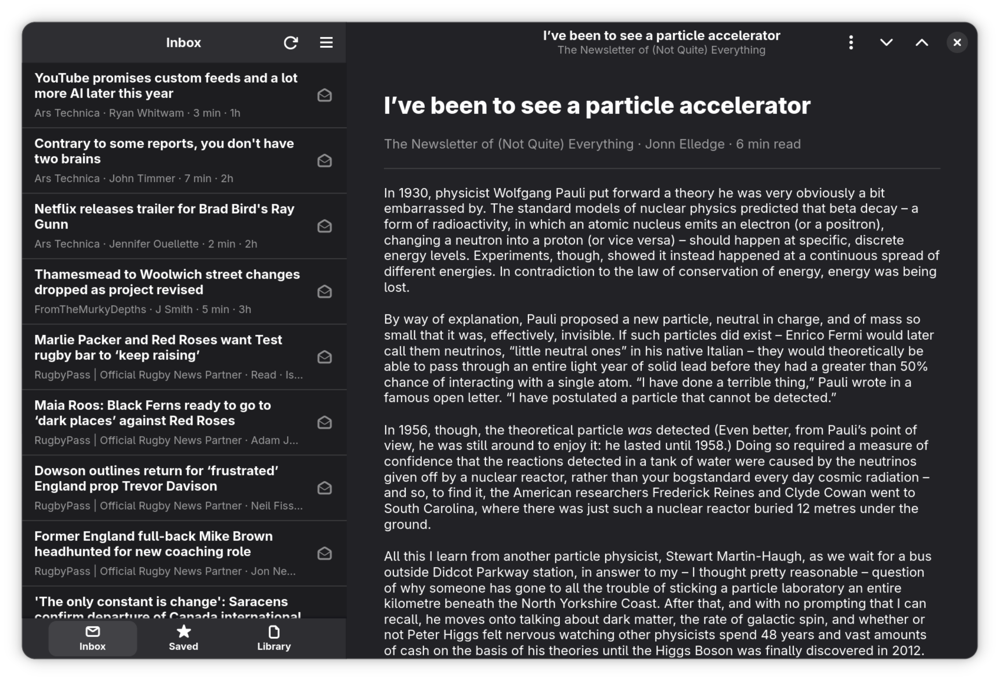

# Brooklet

Brooklet is an opinionated, offline-first Miniflux client for GNOME. It helps
you get through what is new, keep what matters, and read comfortably in a
native GTK interface.

Inbox, Saved and Library share the same controls. Double-click or double-tap
the active destination to return its current list to the top without moving
the reader.

There is also a separately developed Android application with the same vibe,
but a totally different implementation. I hope you enjoy either, neither or
both.



## Install a release

Download the Flatpak bundle for your architecture from
[GitHub Releases](https://github.com/nedrichards/brooklet-linux/releases).

```sh
flatpak install --user ./Brooklet-v0.1.2-x86_64.flatpak
```

Use the `aarch64` bundle for ARM64 systems. GitHub bundles are release snapshots;
install a newer bundle to update. For the updateable local `brooklet-local`
repository, see [Local Flatpak installation](docs/maintenance.md#local-flatpak-installation).

## Native build

```sh
meson setup build
meson compile -C build
meson test -C build
```

Native development requires GTK 4.24, libadwaita 1.10, Blueprint Compiler,
Meson, Cargo, and Rust 1.93 or later but Flatpak is the only supported or
encouraged environment.

## Core tests without GTK

The non-UI domain and service code deliberately builds without GTK:

```sh
cargo test --all-targets
cargo fmt --check
cargo clippy --all-targets -- -D warnings
```

Setup logic is tested without credentials or a live service through injected
validator, repository, and secret-store implementations. The Flatpak smoke
test also constructs the main window, setup dialog, and shortcuts dialog:

```sh
flatpak-builder --run build-dir \
  flatpak/com.nedrichards.brooklet.Devel.json \
  brooklet --smoke-test
```

## Licence

Brooklet is licensed under GPL-3.0-or-later. See `COPYING`.
